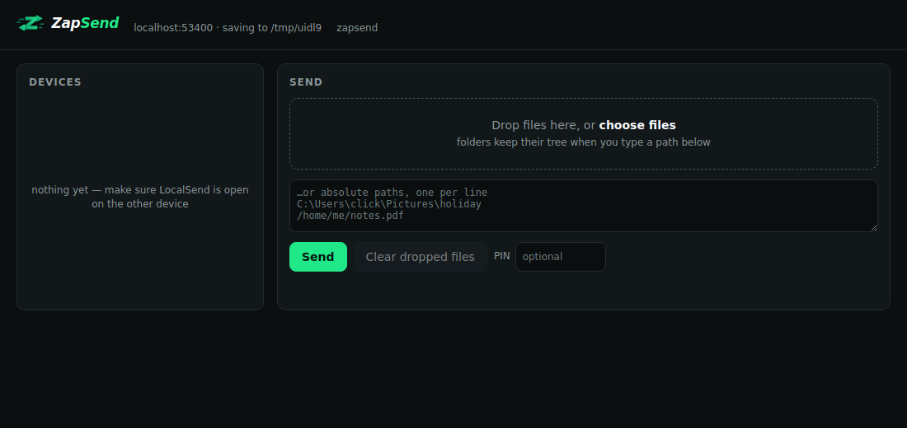

<p align="center">
  
</p>

# zapsend

**LocalSend for the machines nobody is sitting in front of.**

One binary that speaks the real [LocalSend](https://localsend.org) protocol — so
the other side needs nothing installed — and treats several hosts as one:
fan-out, fan-in, a watched folder, and a sync that asks before it sends.

| | |
|---|---|
| **Pick it when** | the other end cannot run rsync: a phone, a Windows box without SSH, a locked-down appliance. Or when several servers should behave like one mailbox, driven from cron. |
| **Skip it when** | both ends have SSH — use rsync, it is thirty years better at it. Or when you need one file on one device: `lsq`, `lsend-cli` and `localsend-rs` all do that already. |
| **It is not** | a GUI, a Syncthing replacement, or a cloud service. Nothing leaves your network. |

```
$ zapsend send film.mkv --to pixel
sending film.mkv to "pixel" (192.168.1.42:53317)
film.mkv [============>               ] 1.2 GiB/4.1 GiB (12s)
✓ done
```

> **Status: v0.0.22.** Send, receive, resume, folders, fan-out, fan-in, a
> watched folder and sync all work, and interop is checked in all four
> directions against an independent implementation. No GUI, and no users yet
> beyond the author — see [roadmap](#roadmap).

---

## Why

LocalSend already exists, and it is good. But it is a GUI app: there is no
official way to send a file *from a server*, over SSH, from a cron job, or from
a box with no display. The protocol even reserves `deviceType: "headless"` for
exactly this, and the official CLI has been promised but is not out.

That gap has not gone unnoticed. `localsend-rs`, `lsq`, `lsend-cli` and
`localsnd` all fill part of it, and some are further along than this one. **If
you need one file on one device, any of them will do** — pick the one that
works for you.

Zapsend's angle is the fleet, not the single transfer: `send --to a,b`,
`pull --to a,b`, `daemon --to a,b`, and `sync`, which asks the other side what it
already holds. Several servers behaving like one mailbox, driven from cron, with
JSON and exit codes an agent can read. If that is your problem, this is shaped
for it. If it is not, rsync over SSH is better software than this, and it is
thirty years older.

Because zapsend speaks the real protocol, **the receiving device does not need
zapsend**. Anything that runs LocalSend — Android, iOS, Windows, macOS, Linux —
can talk to it. Interop is checked in both directions against `lsq`, an
independent implementation: see `tests/interop-lsq.sh`.

## Install

```sh
cargo install --git https://github.com/Urdemonlord/zapsend
```

Or build locally:

```sh
git clone https://github.com/Urdemonlord/zapsend
cd zapsend && cargo build --release
./target/release/zapsend --help
```

Single static binary. No runtime dependencies. Runs on x86_64 and aarch64,
including a Raspberry Pi.

## Running it across a fleet of machines

If the machines are yours — servers running agents, a VPS, your laptop — and the
data has to move between them without a cloud in the middle, read
**[docs/agent-fleet.md](docs/agent-fleet.md)**: one `receive` per machine as a
mailbox (`--dir` in, `--share` out), systemd unit and Windows scheduled task,
pulling results back to the laptop, and what still needs typing by hand.

## Try it in 30 seconds

`demo.sh` runs both ends on one machine and verifies the result:

```sh
./demo.sh
```

```
▸ starting receiver on :53400
  peer fingerprint ab9628b112df49e2…
▸ discovering devices
ALIAS                    ADDRESS              TYPE       FINGERPRINT
nas                      192.168.1.77:53400   headless   ab9628b1…
▸ sending 3 files over discovery (fingerprint pinned automatically)
sending 3 file(s), 13.3 MiB to "nas" (192.168.1.77:53400)
  pinned to ab9628b1
✓ done
▸ verifying
✓ photo.jpg  0ee1cf51e902ff3f…
✓ notes.pdf  2d75bb88795c4827…
✓ clip.mp4   7d99e9346049726a…
▸ rejecting a wrong fingerprint
✓ wrong fingerprint was refused
```

If your network blocks multicast (guest wifi, corporate VLAN, many VMs, a phone
hotspot), the script detects that and falls back to `--ip`, printing why.

`discover` and `send --to` do the same thing automatically: when nothing answers
multicast, they unicast `POST /register` to every host on their own `/24` (the
spec's legacy discovery), which gets through where multicast does not. If the
default port is already held — usually by a running `receive` — they announce a
free port instead of going blind.

## Usage

### Find devices

```sh
$ zapsend discover
scanning for 5s…

ALIAS                    ADDRESS              TYPE       FINGERPRINT
pixel                    192.168.1.42:53317   mobile     9f2c1ab4…
thinkpad                 192.168.1.10:53317   desktop    c41e77d0…
```

### Remember a machine, then stop typing flags

Discovery only works on one subnet. For a machine you talk to often — a VPS, a
box on a VPN — remember it once:

```sh
zapsend trust gpu-box --ip 100.64.0.7 --pin 4021
```

That reaches the machine, records its certificate fingerprint, and stores the
address, port and PIN under the name. From then on:

```sh
zapsend send ./dataset --to gpu-box     # verified, PIN included
zapsend pull --to gpu-box --dir ./out
zapsend doctor --to gpu-box
```

```
NAME                 ADDRESS                    PIN   FINGERPRINT
gpu-box              100.64.0.7:53317           yes   9f2c1ab4
```

The fingerprint is what makes the connection *verified*: it is pinned, so a
machine that shows up on that address with a different certificate is refused.
If you already know the fingerprint, pass `--fingerprint` and `trust` will check
it against the machine instead of trusting on first sight. Without a reachable
machine, `--fingerprint` still lets you save it for later.

`--pin` beats `ZAPSEND_PIN` beats the stored PIN, so a fleet can inject the
secret through the environment instead of writing it to disk. The file lives at
`~/.config/zapsend/hosts.json` (`%APPDATA%\zapsend\hosts.json` on Windows),
is written `0600`, and `ZAPSEND_CONFIG` points elsewhere. `zapsend hosts` lists
what you have, `zapsend forget <name>` removes one.

### Send files

```sh
zapsend send report.pdf --to pixel
zapsend send photo.jpg notes.pdf clip.mp4 --to pixel

# or skip discovery entirely, including a non-default port
zapsend send report.pdf --ip 192.168.1.42
zapsend send report.pdf --ip 192.168.1.42:53400
```

A folder argument is walked recursively and arrives with its tree intact:
`zapsend send ./holiday --to pixel` lands as `holiday/2024/img.jpg` on the other
side. Folders and single files mix freely in one command. Empty folders are not
recreated — the protocol has no way to express a directory without files.

The receiver shows a normal LocalSend prompt — accept it there and the files land.

### Resume a transfer that broke

A dropped Wi-Fi connection used to mean starting a 4 GB video over. Now the
receiver keeps what arrived and the sender asks where to continue:

```sh
zapsend send ./video.mp4 --to "Pixel"          # connection drops at 60%
zapsend send ./video.mp4 --to "Pixel"          # continues from 60%
```

The partial file lives in `<download dir>/.zapsend-parts/` and is named after the
file itself — name, size and SHA-256 — so it survives a receiver restart too.
Before appending, the sender asks `GET /resume` for the stored offset *and* the
SHA-256 of exactly those bytes; if the prefix is not the same file, the transfer
starts over instead of splicing two different files together. A finished file is
only moved into place once its full checksum matches what the sender announced.

Notes:

- this needs a zapsend receiver: it advertises `zapsendResume` in `info`, and
  real LocalSend peers are sent the plain upload instead
- `--retry N` (default 3) controls how many times a single file is retried
  within one `send`; a dropped connection is retried automatically

Pulling resumes too. The receiver honours `Range: bytes=N-`, so `zapsend pull`
keeps what it already has in `<name>.part` and asks for the rest:

```sh
zapsend pull --to server --dir ./checkpoints      # dies at 60%
zapsend pull --to server --dir ./checkpoints      # continues from 60%
```

Before appending, the client asks `GET /verify-download?offset=N` for the
SHA-256 of the first N bytes of the file the peer is sharing, and compares it
with its own partial. A mismatch — a different file, a file that changed, a
truncated write — throws the partial away and starts over instead of gluing two
files together. If the receiver restarted and forgot the download session, the
client asks for a new one and keeps the bytes it already has. A plain LocalSend
peer has no such route, so a resumed pull from one of those simply starts over.

### Script it: `--json` and exit codes

Every one-shot command takes `--json`, and `ZAPSEND_JSON=1` sets it for a whole
session so an agent does not have to pass the flag to each call. Detection of a
pipe was considered and rejected: it would silently rewrite the output of every
script already reading ours.

With `--json`: stdout becomes exactly one JSON object,
human progress stays on stderr, and the verdict stays in the exit code.

```sh
zapsend pull --to server --dir ./in --json | jq -r '.files[].name'
zapsend discover --json | jq -r '.devices[] | "\(.alias)\t\(.ip)"'
zapsend send ./report.csv --to server --json | jq -e '.ok'
```

Exit codes: `0` the thing you asked for happened, `1` it did not (the reason is
on stderr, as `{"ok":false,"error":"…"}` under `--json`), `2` the command line
itself was wrong. Nothing else is printed on stdout, so a script never has to
strip a banner or a progress bar.

### Browse and send from a browser

```sh
zapsend ui --dir ~/Downloads
```



Starts the normal receiver plus a page on `http://127.0.0.1:53318/` (plain
HTTP on loopback, so no certificate warning; peers still get HTTPS on 53317).
The page lists discovered devices, takes drag & drop or absolute paths, and
sends. Dropped files are staged to a temp dir first — browsers hand over bytes,
never a path — so drop a folder as a path if you want its tree preserved.

```sh
zapsend ui --ui-port 8080 --no-open    # different page port, don't launch a browser
```

### Watch a folder and send automatically

```sh
zapsend daemon --dir ./outbox --to "Pixel"
```

Anything that lands in `./outbox` is sent to that device, then moved to
`./outbox/.sent` so it is not sent twice. Folders are sent as a tree, same as
`zapsend send`.

```sh
zapsend daemon --dir ~/Pictures --ip 192.168.1.42 --keep
zapsend daemon --dir ./outbox --to "Pixel" --settle 10   # big slow copies
```

- **Polling, not inotify** — one directory read per `--interval` (default 2s).
- **A file is only sent once it has stopped changing.** A tree has to sit
  untouched for `--settle` seconds (default: twice `--interval`, at least 3), so
  a copy in progress is never shipped half-finished.
- **Delivery survives the other device being away.** If the send fails the file
  stays put and is retried on the next tick; the error is printed once, not
  every tick. The target is re-discovered each time, because addresses move.
- **Ignored names:** dotfiles, `~$*` (Office locks), and `*.tmp`, `*.part`,
  `*.partial`, `*.crdownload`, `*.download`, `*.swp`, `*.filepart`.
- **`--keep`** leaves files in place instead of moving them, remembering what it
  already delivered for as long as the daemon runs.
- The daemon runs the normal API server so peers can see it, which means it can
  also receive: anything pushed to it lands in `<dir>/.incoming`.

### Diagnose a broken network

```sh
zapsend doctor
zapsend doctor --to "Pixel"
zapsend doctor --ip 192.168.1.42
```

Every line is something the tool actually observed, and the first ✗ is the
answer:

```
zapsend doctor

  version     0.0.11
  device      "AZAZEL" (headless)
  fingerprint ab9628b1
  api port    53317
  ✓ address   192.168.1.20 (default route)
  ✓ port      :53317 is free
  ✓ download  ./zapsend-received (writable)
  ✓ multicast 1 device(s) answered
              "Pixel" https 192.168.1.42:53317
  ✓ peer      "Pixel" 192.168.1.42:53317 over https (LocalSend 2.1)
              fingerprint matches what discovery announced
```

Checks, in the order they gate each other: an IPv4 address exists → the API port
is free → the download dir is writable → multicast gets answers → a `/24` sweep
gets answers → a named device answers `GET /info` and its certificate matches the
fingerprint it announced. Exit code is non-zero when anything failed, so it can
be used in a script.

The `--ip` form is the one to reach for when discovery is silent: it skips
multicast entirely and tests the connection you actually intend to use.

### Pull files from a device that shares a folder

The Download API runs the other way: the receiving side offers a directory, and
you fetch from it.

```sh
# on the machine that has the files
zapsend receive --share ./photos --pin 424242

# on the machine that wants them
zapsend pull --to "AZAZEL" --pin 424242
zapsend pull --ip 192.168.1.20 --pin 424242 --dir ./downloads
zapsend pull --ip 192.168.1.20 --file "2024-06"        # only matching paths
```

The receiver prints `sharing ./photos (Download API on)` when it is offering
files, and its `info` advertises `"download": true` so peers know to ask.

**A browser works too.** `GET /` on the same port and the same PIN serves a page
listing every shared file with download links — so a device with no LocalSend at
all can take a file. No extra port and no extra listener: with no `--share`
there is no page. The page has no scripts, no fonts and no CDN, because the
networks this runs on often have no internet.

What `--share` will not do:

- it never shares anything by default — receiving and sharing are separate
- dotfiles are skipped, both in the listing and by direct file id
- symlinks are not followed, and a requested path that resolves outside the
  share root is refused
- `/download` needs a session id from `prepare-download`, so the share is not an
  open file server
- the PIN guards the file list, with the same per-address lockout as uploads
- a pull never overwrites: a second copy of `a.txt` lands as `a (1).txt`

One deliberate limitation: the share is served over HTTPS only, so a browser
warns about the self-signed certificate once before showing the page. The
protocol's browser mode uses plain HTTP for exactly that reason; zapsend keeps
one listener, so the warning stays. If the PIN is set, it rides in the query
string (`/?pin=…`) — a browser cannot send a header of our invention, and the
same trade is what makes LocalSend's own share link work.

### Receive files

```sh
zapsend receive --dir ~/Downloads

# require a PIN — omit the value and one is generated for you
zapsend receive --dir ~/Downloads --pin
zapsend receive --dir ~/Downloads --pin 424242

# confirm each transfer instead of accepting silently
zapsend receive --dir ~/Downloads --ask
```

```
  +--------------------------------------------+
  | zapsend 0.0.1                              |
  | headless file transfer, LocalSend protocol |
  +--------------------------------------------+

  listening   :53317
  alias       thinkpad
  fingerprint ab9628b112df49e2cafce94d17bb062a
  pin         none — anyone on this network can send to you
  saving to   /home/you/Downloads
  mode        accept automatically

  ctrl-c to stop
```

Keeps running, announces itself on the network, and accepts incoming transfers.
Now every phone on your LAN can push files to your NAS.

Silent acceptance is the right default for a NAS or a server: nothing to approve,
nothing to click. On a laptop you probably want `--ask` instead, which shows the
sender and the file list and waits for `y`. It refuses to start if stdin is not a
terminal, so it cannot hang under systemd.

Printing the PIN is deliberate: it goes to your terminal, not to the network.
Peers find out a PIN is required only when they get a `401`.

### Run two instances on one machine

The protocol keeps multicast on `53317` but lets the API live elsewhere, so:

```sh
zapsend receive --port 53400 --alias nas --dir ./inbox
zapsend discover            # finds "nas" on :53400
```

## How it works

Zapsend implements [LocalSend protocol v2](https://github.com/localsend/protocol):

| Piece | What zapsend does |
|---|---|
| Discovery | UDP multicast to `224.0.0.167:53317`, plus the `POST /register` handshake; an `announce: true` datagram is answered with a register request; `/24` unicast sweep when multicast is blocked |
| Identity | Self-signed cert; the sender pins the peer's SHA-256 fingerprint |
| Identity | `GET /info` so a peer can be checked before a transfer starts |
| Transfer | `POST /prepare-upload` for metadata, then `POST /upload` streamed; the session is bound to the sender's address and a token is spent once its file lands |
| Download | `POST /prepare-download` for the share listing, then `GET /download` per file, honouring `Range: bytes=N-` |
| Resume | `GET /resume` for the stored offset + prefix checksum, then `POST /upload?offset=N`; `GET /verify-download` does the same for pulls |
| Cancel | `POST /cancel?sessionId=…` drops the session, as the spec asks |
| Ports | Multicast always `53317`; API port configurable via `--port` |

Everything is streamed — a 40 GB file does not touch RAM. Incoming file names
are sanitized, and existing files are never overwritten (`a.txt` → `a (1).txt`).

### Security model

LocalSend uses self-signed certificates, so there is no CA to trust. Trust comes
from pinning instead:

1. Discovery tells you the peer's fingerprint — the SHA-256 of its certificate.
2. When connecting, zapsend accepts **only** the certificate hashing to that
   exact value. Anything else fails the handshake before a byte is sent.

That means a machine-in-the-middle on the LAN cannot impersonate a peer, even
though the certificate is self-signed. It also means the fingerprint is the
whole security story: if you pass `--fingerprint` by hand, get it from
`zapsend discover` on the same network, not from a chat message.

Sharing is the one place where zapsend hands files *out* instead of taking them
in, so it is deliberately opt-in and narrow: `--share DIR` is required, dotfiles
and symlinks are excluded, `GET /download` demands a session id from
`prepare-download`, and every requested path is resolved and checked against the
share root before a byte is read.

Pinning proves *who* you are talking to. A PIN proves *whether you are allowed*.
They solve different problems, and the receiver needs the PIN because sending
requires no confirmation on its side:

- Wrong or missing PIN → `401`, and the sender is told to retry with `--pin`
- Five wrong attempts **from one address** → `429`, that address locked for 60s

That throttle is what makes a 6-digit PIN meaningful; without it, 10^6 guesses
over a LAN is an afternoon script. It is scoped per source address on purpose: a
global counter would let any stranger on the network lock the owner out of their
own receiver by guessing wrong five times.

## Roadmap

- [x] Multicast discovery + `discover`
- [x] `register` handshake over HTTPS
- [x] Send a single file
- [x] Receive into a directory
- [x] Configurable API port (two instances per machine)
- [x] Multiple files per transfer
- [x] Fingerprint pinning on send
- [x] Folder transfer
- [x] Resume interrupted transfers — `GET /resume` + `POST /upload?offset=N`
- [x] PIN-protected receiving
- [x] Interactive accept prompt (`--ask`)
- [x] `--verbose` payload dumps for protocol debugging
- [x] Local web UI (`zapsend ui`)
- [x] `zapsend daemon` with a watch folder
- [x] `zapsend doctor` — address, port, dir, multicast, sweep, peer reachability
- [x] PIN lockout scoped per address instead of globally
- [x] Download API — `receive --share DIR` plus `zapsend pull`
- [x] `/24` unicast sweep for networks that block multicast (covers the mDNS case)

## Known limitations

- **`--ip` without `--fingerprint` is unverified.** Sending to a raw address
  skips discovery, so there is no fingerprint to pin against; zapsend warns
  and accepts whatever certificate answers. Pass `--fingerprint` (get it from
  `zapsend discover`) to close that hole. Discovery-based sends are always pinned.
- Files are hashed (SHA-256) before upload, which costs an extra read pass.
- **`sync` cannot replace a file.** LocalSend's upload has no overwrite, so a
  file that exists on the peer with different bytes is reported as a conflict
  and the run exits non-zero instead of adding a second copy.
- **`sync` needs a zapsend receiver.** It asks `/api/zapsend/v1/manifest`, an
  endpoint outside the LocalSend spec; against a plain LocalSend app it refuses
  with that explanation rather than re-sending everything.
- `sync` and `daemon` walk one folder level by level but do not follow
  symlinks, by design.
- **Interop is verified against LocalSend on Android only.** Both directions
  round-trip (phone→PC receive, PC→phone send) and the two see each other in
  discovery. iOS, macOS and the LocalSend desktop builds are untested; the wire
  format follows the spec but nobody has run them.

## Troubleshooting

Start with `zapsend doctor` — it checks the address, the port, the download dir,
multicast, the `/24` sweep and (with `--to`/`--ip`) the peer itself, and the first
✗ is the answer.

**No devices found.** Most likely the network blocks multicast — common on
guest wifi, corporate networks and some university APs. Use `--ip <address>`.

**`:53317` is already in use.** Another LocalSend or zapsend holds it. `receive`
stops with an error on purpose — a receiver that cannot listen is useless. Send
and discover announce a free port instead and keep working.

**Receiver rejects the transfer.** Some LocalSend configurations require
accepting manually. Check the screen of the receiving device.

## Brand

The mark is a Z built from two arrows — one leaving, one arriving — with speed
dashes for the "zap". All of it is vector, and the wordmark is outlines rather
than live text, so the logo renders identically with no font installed.

| File | Use |
| --- | --- |
| `assets/logo.svg` | Lockup on a dark card (README, slides) |
| `assets/logo-mark.svg` | Icon only, transparent — UI, favicon, docs |
| `assets/wordmark.svg` | Wordmark only, transparent |
| `assets/app-icon-dark.svg` / `-light.svg` | App icon, dark and light |
| `assets/monochrome-dark.svg` / `-light.svg` | One-ink versions |
| `assets/avatar.svg` | Circular GitHub avatar |
| `assets/*.png` | 1024 px raster exports of the above |

Palette: `#20E889` primary, `#087F68` secondary, `#F8FAFC` text, `#0B0F10`
background. The mark's gradient runs from primary at the top-right arrowhead to
secondary at the bottom-left. The light app icon deliberately uses flat
background ink on primary green instead of the gradient — a mint gradient on a
mint tile would disappear.

`zapsend ui` serves the icon at `/favicon.svg`; the terminal banner uses the
brand colours when stdout is a terminal and `NO_COLOR` is unset.

## License

MIT — see [LICENSE](LICENSE).
